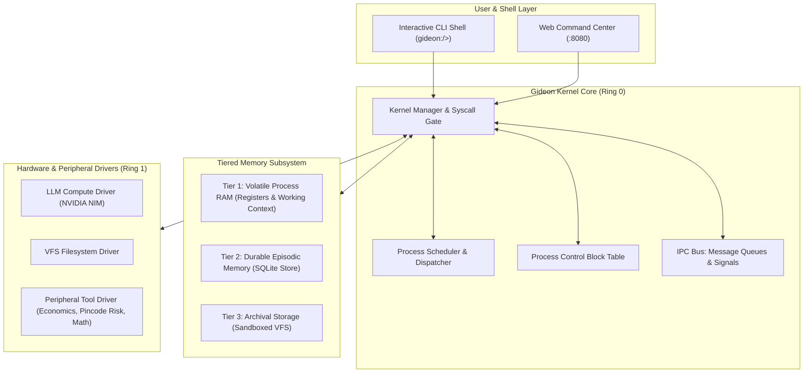

# ⚡ GIDEON: Autonomous Agentic Operating System (POC)

**Gideon** is an Agentic Operating System (Agentic OS) that provides a kernel execution runtime, process management, tiered memory virtualization, inter-process communication (IPC), and hardware driver abstractions for autonomous AI agents.

Named after the advanced intelligence operating system in DC lore, Gideon manages the full lifecycle of specialized AI agents as discrete OS processes (`AgentProcess`), scheduling their execution, governing access to peripheral tools, and managing context window memory.

---

## 1. System Architecture



---

## 2. Core OS Subsystems

### 2.1 Process Management (`AgentProcess` & PCB)
Agents run as managed processes with a Process Control Block (PCB):
- **PID**: Unique process identifier (PID 1 is reserved for `gideon_init`).
- **PPID**: Parent Process ID (supporting agent-spawning-agent hierarchies).
- **State Machine**: `NEW` → `READY` → `RUNNING` → `WAITING_IO` / `WAITING_IPC` → `TERMINATED`.
- **Accounting**: Tracks CPU cycles (inference steps) and token consumption per agent.

### 2.2 Tiered Memory Subsystem
- **Tier 1 (RAM)**: Fast volatile in-memory registers and active context window.
- **Tier 2 (Episodic)**: Durable SQLite database storing agent reflections, structured records, and past execution logs (`data/gideon_memory.sqlite3`).
- **Tier 3 (Archival)**: Sandboxed filesystem driver preventing path traversal attacks.

### 2.3 Inter-Process Communication (IPC) Bus
- **Message Queues**: Point-to-point asynchronous messaging between agents (`SYS_IPC_SEND`, `SYS_IPC_RECV`).
- **Pipes**: Feeding the output of one agent process directly into the input of another (e.g. `Hunter_Agent | Creative_Agent | Store_Agent`).
- **Broadcast Channels**: Notifying all listening processes of system events.

### 2.4 Syscall Interface
All privileged actions execute through standardized syscalls:
- `SYS_SPAWN`: Spawn a child agent process.
- `SYS_KILL`: Terminate a process.
- `SYS_IPC_SEND` / `SYS_IPC_RECV`: Inter-agent message passing.
- `SYS_MEM_STORE` / `SYS_MEM_QUERY`: Durable episodic memory access.
- `SYS_FS_READ` / `SYS_FS_WRITE`: Sandboxed file operations.
- `SYS_TOOL_CALL`: Access peripheral tools (`unit_economics`, `pincode_risk_check`, `calculate`).

---

## 3. How to Launch & Use Gideon OS

### Option 1: Interactive Terminal Shell
Run [start_shell.bat](file:///f:/Dropshipping/gideon/start_shell.bat) or:
```powershell
cd f:\Dropshipping\gideon
..\open-dots\server\.venv\Scripts\python.exe run_gideon.py
```

Available Shell Commands:
- `ps`: View the process table.
- `spawn <name> <task>`: Launch an agent process.
- `step <pid>`: Execute one compute cycle on process `<pid>`.
- `kill <pid>`: Terminate an agent process.
- `ipc`: View message bus history.
- `mem`: View memory subsystem stats and recent episodic records.
- `sysinfo`: Display kernel telemetry, uptime, and token consumption.
- `tool <name>`: Execute a hardware tool syscall (e.g. `tool unit_economics sourcing_cost=270 selling_price=999`).
- `pipeline`: Run an autonomous 3-stage dropshipping launch pipeline.
- `exit`: Shutdown the kernel.

### Option 2: Web Command Center (GUI)
Run [start_web.bat](file:///f:/Dropshipping/gideon/start_web.bat) or:
```powershell
cd f:\Dropshipping\gideon
..\open-dots\server\.venv\Scripts\python.exe run_gideon.py --web
```
Open **`http://127.0.0.1:8080`** in your browser to inspect live processes, view real-time token telemetry, step agent compute cycles, and trigger multi-agent pipelines with one click.

### Option 3: Automated Diagnostic Test
Run:
```powershell
cd f:\Dropshipping\gideon
..\open-dots\server\.venv\Scripts\python.exe run_gideon.py --test
```
Verifies all 7 OS subsystems (Boot, PCB, IPC, Memory, Tools, VFS, and Live NVIDIA NIM Compute).
