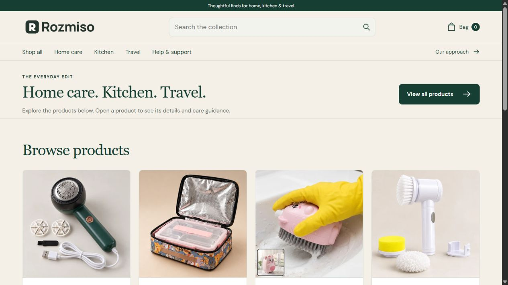
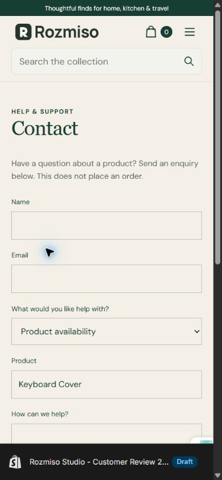

# T030 customer website review

Status: IN_PROGRESS — theme fixes live; catalog upload awaiting connector approval.
Author/reviewer: Codex, main orchestrator. Date: 14 October 2026.

## Delivered

Published **Rozmiso Studio - Customer Review 2026-10-14**, theme **159259001024**, using official Shopify CLI4.9.3. Fresh CLI theme list confirms `role: live`. Previous live158950424768 remains unpublished for rollback. Authoritative source: `F:/Dropshipping/rozmiso-studio-theme`. Baseline backup: `live-baseline/`; source backup: `backups/before-customer-fixes/`.

Delegated bounded engineering review/implementation and primary-source customer research to two workers. Codex integrated and independently checked the changes, reviewed actual rendering, and performed all live writes.

## Customer problems fixed

- Submitted search now uses Shopify native paginated results instead of a separate first50-product index, avoiding disagreements with predictive suggestions.
- Overlapping supplier category chips now share consistent Home care, Kitchen, Travel, Personal care and explicit Other grouping. Exact live punctuation is normalized; all products remain discoverable. Larger catalogs retain native server facets.
- Variant transitions update price, stock/enquiry states, valid quantity limits and selected gallery image consistently. Gallery thumbnails expose selection and correct alternative text.
- Mobile gallery strips stay within the page; menu, cart and zoom keyboard handling and focus were checked. Mobile card titles enlarged to14px.
- Common forest/ivory colors and serif headings now match the approved creative direction, including HTML description heading styling.
- Replaced unsupported preview/orders-not-open statements with factual final public copy and neutral product availability. Homepage metadata now uses the factual theme description. Cart's unavailable explanation is distinct from the brand announcement.

Inventory, overselling rules, payment providers and the cart/checkout commerce guard were not bypassed. Unavailable products still display unavailable; changing that requires genuine operational evidence.

## Verification and limits

| Check | Result |
|---|---|
| Shopify CLI Theme Check | `[]`, no reported issues; strict theme pushes passed |
| Meaningful jsdom/Liquid regression fixtures |11/11 PASS, independently rerun by Codex |
| Uploaded theme pulled back before publication |40 source files; missing0; mismatches0 after normalizing generated JSON comments/line endings |
| Fresh post-publication state | CLI live role plus public homepage without preview parameter |
| Mobile390px and320px | Catalog, filters, search/no-results recovery, galleries/zoom, menu/cart and contact sampled; no page overflow in measured samples |
| Catalog behaviors | All21 discoverable; Personal care filter; price filter; ascending sort; Clear restores21 |
| Product behaviors | Pouch gallery selection/zoom and enquiry prefill; keyboard unavailable state; Escape closes overlays |
| Contact | Product/topic prefill and required email/message validation; no real submission |
| Buying journey | Successful checkout/payment/order/notification/refund NOT tested |
| Performance/accessibility | No measured Core Web Vitals claim or full WCAG certification |

`CHANGED-FILES.json` contains final source hashes. `DRAFT-INTEGRITY.json` records the40-file remote comparison. Fixture tests stub Shopify-only pagination/render plumbing; they do not substitute for backend transactions or large-catalog live testing. Contact custom-field preservation after a server error remains unverified.

## Catalog work prepared, not uploaded

`catalog-ready/manifest.json` indexes21 products, each with six product-specific AI images plus a matching HTML description. Total126 images. Shared social CTA excluded. Correct pouch hero and the new upholstery-brush/hanging-organizer studio frames are included. Originals and hash-bound sources retained. Existing live galleries remain mixed until this upload completes.

Theme CLI authentication is complete. Product CLI requires installation of Shopify's CLI Connector App. The installation screen requests view/edit Products and displayed store-owner data access, and accepts Shopify API Terms. Explicit approval has been requested and is pending. No installation was performed; OAuth callback timed out. Restart authorization after approval, read/backup current catalog, apply minimal product/media mutations and verify saved image order/count/content and descriptions on all21 product pages.

## Remaining business dependencies

1. Finish catalog upload after the pending connector decision.
2. Verify real supplier stock, fulfillment costs/timing, return process, seller/support facts and supported payment configuration. Preserve truthful availability until verified.
3. Perform an authorized full checkout/test-order and notification check when prerequisites exist. Reachable interface controls alone are not purchase readiness.
4. Owner purchases/connects rozmiso.in. No domain changes were made. Social current captions use the requested .in domain; Facebook Page website field and mobile-only Instagram website field still require correction.

## Social carryover

All21 referenced active products have current six-slide carousels on both Instagram and Facebook, confirmed by paired Planner publications. Instagram21-post count verified. Original two single-image Instagram posts and four superseded carousel versions were deleted; four superseded Facebook versions moved to recoverable recycle bin. Current publication IDs are consolidated in T029/social/published-carousels.json with old metadata preserved. Manual Instagram AI toggle remained off; platform automatic provenance labeling can still apply.

## Evidence screenshots

Fresh live homepage, inspected after publication:

Mobile contact screenshot, inspected at390px during identical draft verification:

The rejected tiny viewport capture is named `REJECTED-viewport-mismatch-320.jpg` and is not acceptance evidence. Original JPEG captures retained; PNG copies preserve their pixels for reliable viewing.

## Research applied

The reviewer used current primary guidance for [Shopify launch testing](https://help.shopify.com/en/manual/intro-to-shopify/initial-setup/setup-prepare-for-launch), [Shopify theme accessibility](https://shopify.dev/docs/storefronts/themes/best-practices/accessibility), [W3C reflow](https://www.w3.org/WAI/WCAG22/Understanding/reflow.html) and [Web Vitals](https://web.dev/articles/vitals). These informed the test criteria and the limits above; they do not establish this store's compliance or transaction readiness. Full evidence and criteria: `research/WORK-REPORT.md`.

## Codex acceptance

ACCEPTED for the bounded theme fixes, source tests, remote integrity and sampled customer flows. NOT accepted as completed catalog replacement or complete commercial launch. T030 remains IN_PROGRESS with explicit dependencies above. Single ongoing handoff log: `F:/Dropshipping/WORK-LOG.md`.
