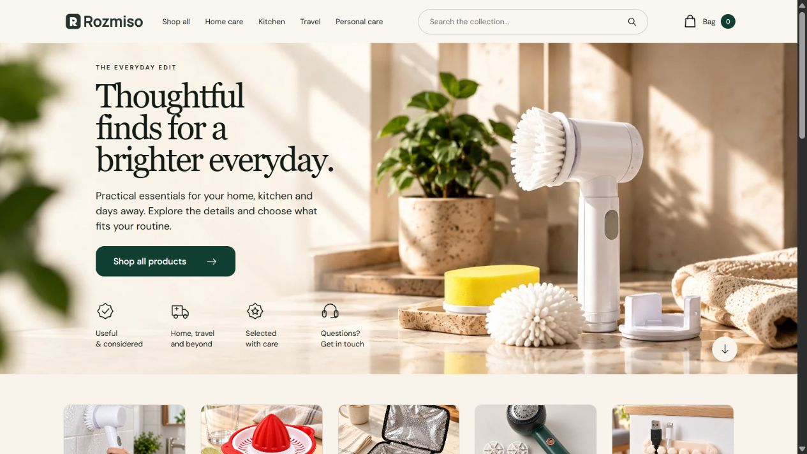

# T031 reference landing page

Status: ACCEPTED for the landing-page design scope; LIVE22 October2026.
Orchestrator/reviewer: Codex. Contributors: landing_build and chrome_build.

## Result

Published **Rozmiso Reference Landing2026-10-22**, Shopify theme **159552962752**, through official Shopify CLI4.9.3. Previous live159259001024 retained unpublished for rollback. Source: `F:/Dropshipping/rozmiso-studio-theme`. Reference saved as `reference.png`; original local source in `source-backup/`, previous live backup in `live-baseline/`.

Recreated the supplied layout: single-row header, warm full-width cleaning-brush hero, large serif heading, forest CTA, four small line-icon points, five category tiles, four featured products, sink banner, four benefits, travel banner and deep-forest footer. Responsive mobile uses reflowed image/text and horizontally scrollable category/product rows. Product cards read native Shopify titles, prices and availability.

This is a close implementation of the supplied composition, not a claim of pixel-identical source photography. Deliberate factual differences: no invented ratings/review counts, pan-India delivery or quality guarantees; cable pack uses actual Set of20 title instead of reference's Set of6. Footer includes only existing policies and verified Instagram/Facebook destinations. No false YouTube/Pinterest links. Native stock guard preserved.

## Product correction

Owner rejected older soap-brush03-usecase: invented bristle plane and side cap. Three supplied original photos saved in `product-reference/` and treated as authority. New `generated/soap-corrected.png` preserves face-up shell, flat rear grey bristle bed, cap between ears and supplied yellow-glove use pose. Lighting/background refined. Root visual review plus independent `chrome/PRODUCT-QA.md`: PASS within visible evidence. No measurement certification or hidden-geometry guarantee.

Older T028/T029 soap-brush media and T030 soap catalog set are held for correction/re-review; do not reuse previous acceptance as proof. This task replaced the landing-card asset, not all existing product galleries or social posts. Product catalog API installation approval remains a separate unresolved earlier task.

## Imagery and prompts

Built-in image_gen produced four saved PNGs in `generated/`: hero, home, travel, soap-corrected. Exact prompts and reference mappings: `generation-prompts.json`. Existing AI product imagery supplied the other category/card images. `prepare-assets.py` creates12 WebP theme derivatives, total953972bytes; originals retained. `ASSETS.json` records source, dimensions, byte size and SHA256.

## Verification

- Fresh pre-change CLI list verified159259001024 live; no stale theme assumption.
- Official Theme Check output `[]`; strict pushes passed.
-3 landing render fixtures and11 retained regression fixtures PASS, independently rerun by Codex. These stub Shopify render plumbing and do not establish checkout behavior.
- Remote theme pulled after publication: **57 files, missing0, mismatches0** with canonical JSON/generated-comment and line-ending normalization. `REMOTE-INTEGRITY.json`, `SOURCE-HASHES.json`.
- Four native featured products render prices299,149,649,299 INR and actual unavailable states. No prices/stock/payment settings changed.
- Desktop1536 and fresh live1265 screenshots inspected. Root caught inherited `#the-edit` spacing collision and renamed anchor; corrected widths toward supplied reference.
- Mobile390px page375px including scrollbar allowance: no whole-page overflow. Product carousel Next moved175.2px, bag opened, Escape closed, juicer search returned one actual result. Earlier read immediately after smooth-scroll click showed0; later settled observation confirms movement.
- Independent reviewer flagged tablet clipping; live preview820px confirmed home163px vs229.1px copy and travel200px vs270.6px copy. Corrected intermediate band minimum heights260/300. Fresh measurements fit both content stacks; page805px at820 viewport.
- Chrome extension disconnected during final checks; remaining tablet/live verification continued in the in-app browser. Temporary in-app viewport reset.
- No orders, customer messages, payment tests, new apps, terms, account security or domain changes.

## Evidence

`screenshots/desktop-draft.*` and `desktop-reviewed.*` are intermediate reference comparisons. One full-page capture shows sticky-header/focus artifacts from the browser capture position; it is not the clean final screenshot. `screenshots/mobile-top.*` precedes the final fade adjustment. `live-home.png` is the fresh published view. JPEG originals retained with pixel-preserving PNG copies for reliable viewing.

## Acceptance and remaining scopes

Codex accepts the scoped landing implementation, published persistence and observed responsive/functional checks. No full-store commercial-readiness, field performance or accessibility certification is implied. Earlier catalog uploads, seller/fulfillment facts, payment/order testing and owner-managed domain connection remain separate open work. Single ongoing handoff: `F:/Dropshipping/WORK-LOG.md`.
